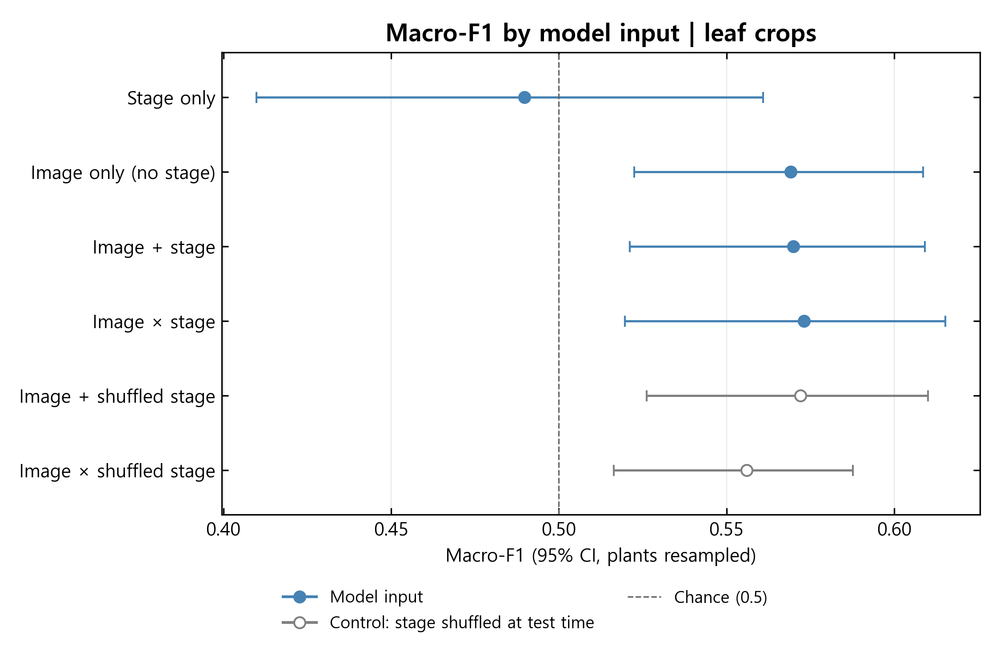
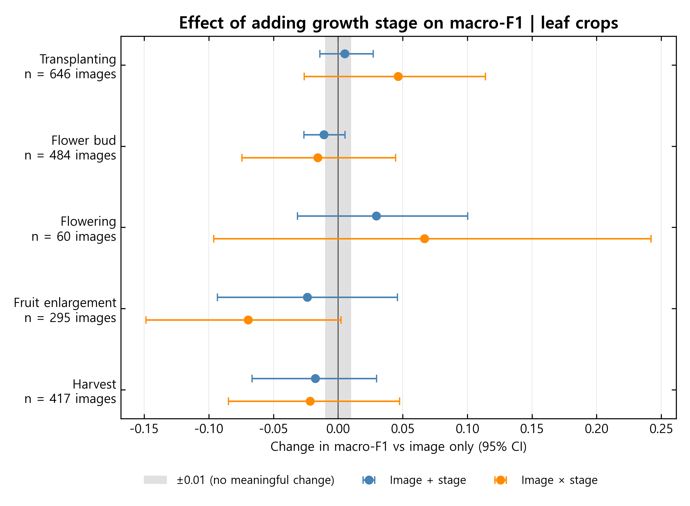
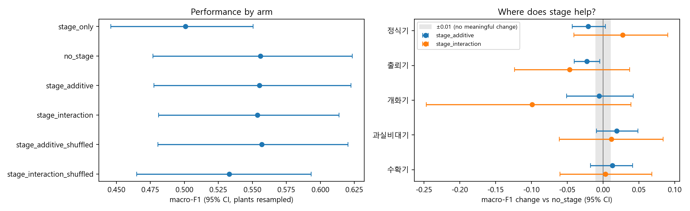

# Does Growth Stage Help Strawberry Condition Classification?

A Python ablation study testing whether growth-stage information improves classification of **leaf tipburn (`잎끝마름`)** and **yellowing (`황화`)** labels in Seolhyang strawberry images. The study compares image-only, stage-only, additive-stage and stage-interaction models using held-out plants.

**Main finding:** neither the full-image experiment nor the leaf-crop experiment establishes a meaningful improvement from growth-stage conditioning. The estimated overall changes are small, and the paired uncertainty intervals include both benefit and harm. This is an inconclusive result, not proof that growth stage is irrelevant.

## Ablation figures

### Leaf crops: performance by model input — 1,902 images



[Open the full-size input comparison](figures/leaf_crop_by_input.png)

Filled blue points show model inputs; open grey points show the same stage models evaluated with shuffled test-stage inputs. Error bars are 95% intervals obtained by resampling plants. Macro-F1 averages the F1 scores of the two classes; it is not classification accuracy.

**Reading the reference line:** the supplied figure labels 0.5 as “Chance”. It should be treated as a visual reference, not a calibrated chance benchmark for this macro-F1 experiment. The portable script labels regenerated charts “Reference (0.5)”; the original figure and notebook output are preserved.

### Leaf crops: where does growth stage help?



[Open the full-size stage comparison](figures/leaf_crop_by_stage.png)

Points show changes relative to the image-only model within each stage. The grey band marks **±0.01 macro-F1**, the notebook's chosen practical-difference margin. Each row lists image counts, not independent-plant counts. Stage-specific intervals are exploratory and are not adjusted for multiple comparisons.

### Full-image comparison — 3,503 images



[Open the full-size full-image figure](figures/full_image_ablation.png)

This earlier experiment includes multiple plant parts. The left panel shows overall scores and the right panel shows stage-specific changes.

## Summary

The notebook uses a pretrained ConvNeXt-Tiny model to extract image features, reduces them to 64 principal components inside each training fold, and fits logistic-regression classifiers. Five repeats of five-fold cross-validation keep photographs of the same plant in the same fold. The final predictions average each image's held-out probabilities across repeats.

There are **55 plant groups from one farm**: 33 with the tipburn label and 22 with the yellowing label. The full-image and leaf-crop experiments both contain these plant groups, but different images and different stage-level sample counts. Neither experiment is an evaluation on a new farm.

## What can be found from the results?

### Overall performance

| Model / evaluation | Full images: macro-F1 (95% CI) | Leaf crops: macro-F1 (95% CI) |
| --- | --- | --- |
| Stage only | 0.501 (0.446–0.551) | 0.490 (0.410–0.561) |
| Image only — `no_stage` | 0.556 (0.477–0.623) | 0.569 (0.523–0.609) |
| Image + additive stage | 0.555 (0.478–0.622) | 0.570 (0.521–0.609) |
| Image + stage interactions | 0.554 (0.481–0.614) | 0.573 (0.520–0.615) |
| Additive model, test stage shuffled | 0.557 (0.481–0.620) | 0.572 (0.526–0.610) |
| Interaction model, test stage shuffled | 0.533 (0.465–0.593) | 0.556 (0.516–0.588) |

These values come from the original full-precision CSV exports and agree with the notebook's rounded tables. The shuffled rows evaluate the already-fitted models after scrambling stage inputs in the test fold; they are not separately trained models.

### Does adding stage improve the image-only model?

| Experiment | Comparison with `no_stage` | Macro-F1 change | Paired 97.5% CI |
| --- | --- | ---: | --- |
| Full images | Additive stage | −0.0008 | −0.0166 to +0.0155 |
| Full images | Stage interactions | −0.0022 | −0.0479 to +0.0434 |
| Leaf crops | Additive stage | +0.0007 | −0.0205 to +0.0223 |
| Leaf crops | Stage interactions | +0.0039 | −0.0352 to +0.0440 |

- **Neither stage approach shows a clear overall gain.** Every main interval crosses zero. Every interval also extends beyond both −0.01 and +0.01, so these results do not establish practical equivalence.
- **The largest point-estimate gain is still small:** +0.0039 macro-F1 for leaf-crop stage interactions, below the chosen +0.01 practical margin. Its interval remains wide enough to allow a meaningful gain or loss.
- **Shuffling stage gives suggestive but uncertain interaction effects.** Correct stage inputs outperform shuffled inputs by +0.0208 for full images and +0.0170 for leaf crops, but their 95% paired intervals are −0.0182 to +0.0574 and −0.0220 to +0.0570. This does not establish reliable reliance on useful stage information.
- **The stage-specific plot does not identify a consistently beneficial stage.** Estimates vary across stages and experiments. Those subgroup comparisons should guide further investigation rather than support a firm stage-specific claim.

In the leaf-crop figure, the largest positive interaction estimate occurs at flowering (**+0.0667**), but its 95% interval is **−0.0963 to +0.2420**. That subgroup contains only **60 images from 20 plants**, so the estimate needs particular caution. Fruit enlargement has a negative interaction estimate (**−0.0697**, interval **−0.1485 to +0.0022**). All leaf-crop stage-specific intervals cross zero. In the full-image experiment, the additive model's budding-stage interval is below zero (−0.0400 to −0.0045); that unadjusted exploratory result does not establish a general stage-specific effect.

Download the [overall comparison](results/overall_comparison.csv), [paired comparisons with interval levels](results/paired_comparisons.csv), [leaf-crop stage results](results/leaf_crop/stage_deltas.csv), and [image/plant coverage by stage](results/stage_coverage.csv).

The two main comparisons within each experiment use **97.5% paired intervals**, reflecting the notebook's adjustment for two main comparisons. Overall model intervals, shuffle comparisons and stage-specific intervals use **95%**. Read the paired difference intervals to assess improvement; overlapping model-level intervals alone are not the test.

### What does cropping tell us?

The image-only score is 0.556 in the full-image experiment and 0.569 in the leaf-crop experiment. However, the latter also selects a smaller, leaf-only sample. This comparison changes both image framing and the evaluated image set, so it does not isolate the effect of cropping. A fair follow-up would compare full frames and crops of the same 1,902 images with the same plant folds.

## What are the implications?

1. **Keep an image-only model as the reference for further experiments.** The current evidence does not justify claiming that stage conditioning improves classification. It also does not justify permanently discarding stage information.
2. **Check whether the labels match the intended visual task.** The first annotation is status `N` for 3,281 of 3,503 images (93.7%), `Y` for 202 and `E` for 20. The class label is therefore not interchangeable with the annotation-status field. Confirm the provider's definitions before treating every image as an example of a visible symptom.
3. **Localise the relevant visual information and test that change fairly.** In the full-image data, the median first-annotation box occupies about 1.4% of the frame in each class. The notebook's crop experiment explores this issue, but a matched-image comparison is needed to attribute an effect to cropping.
4. **Seek more independent plants and farms.** Thousands of photos do not provide thousands of independent plants. Additional plants, verified annotations and external-farm evaluation would make the uncertainty and generalisation claims more informative.
5. **Use an explicit baseline comparison.** The notebook's final `0.60` cutoff is a heuristic, not a statistical chance level for macro-F1. Evaluate dummy classifiers or a suitable plant-level label-permutation procedure under the same grouped validation design before making a claim about chance performance.

## Data and model design

| Item | Configuration |
| --- | --- |
| Source labels read | 3,540 |
| Usable full images | 3,503: 1,989 tipburn, 1,514 yellowing |
| Leaf images with crop metadata | 1,902 |
| Independent grouping unit | Farm ID + plant ID; 55 groups |
| Farms represented | One |
| Growth stages represented | Transplanting, budding, flowering, fruit enlargement and harvest |
| Feature extractor | `convnext_tiny.fb_in22k`, frozen, 768 features per image |
| Fold-specific preprocessing | Standardisation → 64-component PCA → standardisation |
| Classifier | Logistic regression, `C=0.5`, balanced class weights, 5,000 maximum iterations |
| Validation | 5 repeats × 5 stratified, plant-grouped folds |
| Uncertainty | 2,000 paired plant-bootstrap resamples of fixed held-out predictions |

The class labels describe dataset categories; this repository does not establish their biological cause. The feature extractor is pretrained on ImageNet-22k, as described in the [official model card](https://huggingface.co/timm/convnext_tiny.fb_in22k).

## Repository files

| File or folder | Purpose |
| --- | --- |
| [`ablation_test.py`](ablation_test.py) | Portable script for both experiments and result exports. |
| [`ablation_test.ipynb`](ablation_test.ipynb) | Supplied notebook with stored outputs, portable input path and interpretation notes. |
| [`figures/`](figures/) | The latest two leaf-crop charts, the original full-image figure and the notebook's crop examples. |
| [`results/full_image/`](results/full_image/) | Full-image overall scores, paired differences and diagnostics. |
| [`results/leaf_crop/`](results/leaf_crop/) | Leaf-crop overall scores and paired differences. |
| [`docs/METHODS.md`](docs/METHODS.md) | Model arms, confidence intervals, caveats and reproduction details. |
| [`docs/VERIFICATION.md`](docs/VERIFICATION.md) | What was checked and which steps were rerun. |
| [`requirements.txt`](requirements.txt) | Core analysis dependencies. |
| [`requirements-features.txt`](requirements-features.txt) | Additional dependencies for fresh image-feature extraction. |

## Run locally

Use Python 3.13, the version recorded in the supplied notebook. Download this repository and open its folder, then create a virtual environment:

```bash
python -m venv .venv
```

Activate it with `.\.venv\Scripts\Activate.ps1` in Windows PowerShell, or `source .venv/bin/activate` on macOS/Linux.

### Run from images

Extract the source JSON-label and image archives into a local data directory. Use a clean directory containing the intended study subset; the script scans all extracted JSON files below it. It does not extract archives or modify the input dataset.

```bash
python -m pip install -r requirements-features.txt
python -X utf8 ablation_test.py --data-dir "path/to/extracted/data" --out "outputs"
```

Fresh feature extraction uses CPU and may take substantial time. The pretrained weights may download on the first run. New feature caches include an ordered-data fingerprint to avoid silently reusing them after input rows or crop metadata change.

### Run from existing feature arrays

```bash
python -m pip install -r requirements.txt
python -X utf8 ablation_test.py --data-dir "path/to/extracted/data" --feature-dir "path/to/feature_cache" --out "outputs"
```

The cache directory must contain `features.npy` for full images and `features_leafcrop.npy` for leaf crops in the **exact row order** of the reconstructed datasets. The script checks dimensions and, if available, compares the original `data.csv` order for full images. Legacy arrays alone cannot prove row identity. Do not reuse them with different image sets or ordering.

Both modes produce separate `outputs/full_image/` and `outputs/leaf_crop/` directories. Rerunning replaces files with the same names there. These local outputs include path-bearing working tables, feature caches and held-out probabilities; they are excluded from Git. The published `results/` folder contains selected aggregate tables.

Korean plot labels use Malgun Gothic by default. On another system, supply an installed Korean-capable font, for example `--font "Noto Sans CJK KR"`. For notebook use, install JupyterLab separately, set `ABLATION_DATA_DIR`, and run the cells in order. The notebook retains its original extraction and cache behaviour, described in its opening notes.

## Limitations and reuse

The bootstrap resamples plants while holding predictions fixed; it does not refit models in each resample. The scores are image-level macro-F1, not equally weighted per-plant scores. Results apply to this one-farm sample, frozen feature representation and classifier setup. No external test set, formal chance test or controlled matched-image crop comparison was supplied.

The local source is the validation subset of `305.시설작물개체이미지 및 시설작물질병이미지`. Raw labels, full-resolution source photographs, pretrained weights and feature arrays are not bundled. The crop-example montage is extracted from the supplied notebook. A provider download link, annotation codebook and data reuse terms were not supplied; no new code or data licence is assigned here.

The README follows the figure-first, findings-and-reproduction style of [Weather Visualisation](https://github.com/isabelhendrick-sudo/Weather_visualisation).
