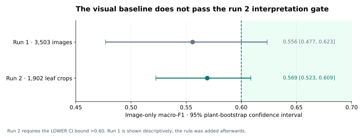
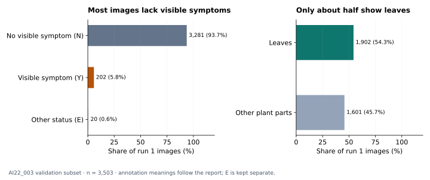

# Growth stage for strawberry nutrient-deficiency classification

Does knowing a strawberry plant's growth stage help distinguish **tip burn (잎끝마름)** from **yellowing (황화)**?

**The stage question remains open.** On held-out plants, the leaf-crop image-only baseline reached **0.569 macro-F1 (95% CI 0.523–0.609)**. Its lower confidence bound did not exceed **0.60**, the interpretation rule set before run 2. Run 2's stage comparisons are therefore **reported but not interpreted**. These results support neither keeping nor dropping stage conditioning.

This repository accompanies **_Growth stage for Strawberry Nutrient Deficiency_**, the report supplied on **11 November 2026**. The reported results are retained; the documentation and executable decision logic now follow the report's two-run sequence and decision rules. This update is not a new training run.



## Why test growth stage?

The motivation is Darlan et al. (2025), [“StrawBerry for AI-based growth stage classification and precision nutrient management in strawberry cultivation”](https://doi.org/10.1038/s41598-025-97168-z). Stage-specific nutrient management motivates the question, but does not itself prove that stage improves a deficiency classifier.

Two possible effects are tested:

| Hypothesis | Model input | Question |
| --- | --- | --- |
| Prevalence shift | Image features + one-hot stage | Does stage help because class frequencies differ across stages? |
| Expression shift | Image features + stage + their interactions | Does the visual distinction between the two labels change with stage? |

Neither label is confined to one stage in this sample. Stage-only performance in run 1 was **0.501 (0.446–0.551)**: no useful stage-only class signal was demonstrated at this farm. This is a sample-specific finding, not a biological claim that nutrient stress is independent of growth stage.

## Data and the reason for restricting the task

The report audits **AI Hub dataset 305**, strawberry cultivar **Seolhyang**. Its open training and validation release contains **172,037 labelled images, five classes and 12 farms**. Farm and class are strongly confounded: tip burn and yellowing occur only at **AI22_003**, while blight and wilt occur at three other farms without healthy plants. A five-class classifier could therefore learn farm differences.

The ablation uses **only tip burn versus yellowing at AI22_003**, with **55 plants: 33 tip burn and 22 yellowing**. The report describes these as nutrient-treatment groups. They are not tissue-confirmed nutrient diagnoses or per-frame guarantees of visible symptoms.

Because the lab server was unavailable, both runs used the **validation split only** (approximately 6 GB). This is the source split's name: the analysis itself uses plant-grouped cross-validation, not an untouched external validation set. The split already covers all 55 plants; adding training-split photos would add images, not new plants.

| Sample | Tip burn images | Yellowing images | Total images | Plants |
| --- | ---: | ---: | ---: | ---: |
| Run 1 — whole images | 1,989 | 1,514 | 3,503 | 55 |
| Run 2 — annotated leaf crops | 1,064 | 838 | 1,902 | 55 |

Of 3,540 source labels, 37 were excluded for a blank growth stage or missing image. Each plant was photographed at 2–5 stages.

| Growth stage | Run 1: tip burn plants | Run 1: yellowing plants | Run 2: tip burn plants | Run 2: yellowing plants |
| --- | ---: | ---: | ---: | ---: |
| Transplanting · 정식기 | 18 | 13 | 18 | 13 |
| Flower-bud emergence · 출뢰기 | 28 | 16 | 28 | 16 |
| Flowering · 개화기 | 14 | 10 | 12 | 8 |
| Fruit enlargement · 과실비대기 | 27 | 22 | 24 | 19 |
| Harvest · 수확기 | 28 | 19 | 28 | 17 |

Plants appear in multiple rows; stage counts must not be added to estimate independent sample size. See [stage coverage](results/stage_coverage.csv). The full-release counts are transcribed separately in [the dataset audit](results/report_dataset_audit.csv).

## Method

All arms use the same images, folds and classifier within each run.

| Component | Setting |
| --- | --- |
| Image features | Frozen `convnext_tiny.fb_in22k`; ImageNet-22k weights; 768 dimensions |
| Fold-specific preprocessing | Standardisation → PCA to 64 dimensions → standardisation; fitted on training plants only |
| Classifier | Logistic regression; `C=0.5`, balanced class weights, `max_iter=5000` |
| Validation | 5-fold `StratifiedGroupKFold`, repeated 5 times; plant = farm ID + plant ID |
| Final prediction | Average each image's held-out probabilities across repeats, then threshold at 0.5 |
| Metric | Image-level macro-F1 across the two classes |
| Uncertainty | 2,000 paired bootstrap resamples of plants, keeping predictions fixed |
| Main comparisons | 97.5% intervals: Bonferroni adjustment for two comparisons per run |
| Other intervals | 95%; stage-specific results are exploratory |
| Hardware | CPU |

| Arm | Inputs |
| --- | --- |
| Stage only | One-hot growth stage |
| Image only | Image features |
| Image + stage | Image features and stage |
| Image × stage | Image features, stage and their interactions |
| Shuffled controls | The fitted additive/interaction models with stage shuffled at test time |

**Decision-rule chronology matters.**

1. **Before run 1:** a gain smaller than **0.01 macro-F1** is not practically meaningful.
2. **After run 1, before run 2:** interpret stage comparisons only if the image-only baseline's **95% lower confidence bound is strictly above 0.60**.

The second rule is a study-specific adequacy screen, not a statistical chance test. It is binding for run 2 even though the comparison numbers can still be calculated. It was not prespecified for run 1. The figures use 0.5 only as a visual reference.

## Run 1 — whole images

Image only scored **0.556 (0.477–0.623)**. Stage only scored **0.501 (0.446–0.551)**. All arms were between about 0.50 and 0.56. The stage comparisons were inconclusive.

| Paired comparison | Δ macro-F1 | CI | Level |
| --- | ---: | --- | ---: |
| Image + stage − image only | −0.001 | −0.017 to +0.016 | 97.5% |
| Image × stage − image only | −0.002 | −0.048 to +0.043 | 97.5% |
| Image + stage − shuffled control | −0.002 | −0.019 to +0.014 | 95% |
| Image × stage − shuffled control | +0.021 | −0.018 to +0.057 | 95% |

The weak visual baseline prompted a label/region audit and the additional baseline rule for run 2.

## Why is the visual baseline weak?



- **3,281/3,503 images (93.7%)** are annotated as showing no visible symptom; **202 (5.8%)** as symptomatic. The remaining 20 have status `E` and are shown separately.
- The report's symptomatic subset scored **0.534 macro-F1 (n=202)** versus **0.558** on the remaining images. This subset is small.
- Only **1,902 images (54.3%)** show leaves, although tip burn and yellowing are leaf symptoms.
- The annotated box occupies a median of approximately **1.4%** of the full frame (IQR approximately **0.6–3.0%**), making relevant detail small at model input size.
- These are per-plant time series. A plant's treatment-group label can precede visible symptoms. Growth stage and time since treatment therefore vary together.

The report further records visible symptoms in only approximately 3–10% of images at each stage, without a steady increase towards harvest. This is evidence of a mismatch between treatment-group labels and a per-image visual classification task.

## Run 2 — leaf crops

Run 2 retains leaf images only and uses a square crop centred on the first annotated box, with side length **1.5 × the longer box dimension** (`pad=0.5`). This is the implementation of the report's “50% margin”: it is not 50% extra on each side. Features, classifier and validation settings are otherwise unchanged.

| Model / evaluation | Macro-F1 | 95% CI |
| --- | ---: | --- |
| Stage only | 0.490 | 0.410–0.561 |
| Image only | **0.569** | **0.523–0.609** |
| Image + stage | 0.570 | 0.521–0.609 |
| Image × stage | 0.573 | 0.520–0.615 |
| Image + shuffled stage | 0.572 | 0.526–0.610 |
| Image × shuffled stage | 0.556 | 0.516–0.588 |

**All run 2 stage comparisons are reported for completeness and are not interpreted**, because **0.523 ≤ 0.60**. Neither the small positive point estimates nor the shuffled controls override this rule.

The image-only confusion matrix from report Table 6 is:

| True class | Predicted tip burn | Predicted yellowing | Recall |
| --- | ---: | ---: | ---: |
| Tip burn | 636 | 428 | 0.598 |
| Yellowing | 384 | 454 | 0.542 |

The baseline rises from 0.556 to 0.569 across runs, but run 2 changes both framing and the image subset. This is not an isolated estimate of the effect of cropping.

See [complete paired results](docs/RESULTS.md), [full-precision scores](results/overall_comparison.csv), and [interpretation status](results/interpretation.json).

## What follows from this?

**There is no basis here for keeping or dropping growth-stage conditioning.** First establish an adequate visual baseline on unseen plants; then ask whether stage adds value.

The report's next steps are:

1. Evaluate a post-onset subset, from each plant's first recorded symptomatic image onwards, provided approximately **15 plants per class** have a recorded onset. Verify symptoms in the retained frames: being after onset does not guarantee every photographed organ is symptomatic.
2. Fine-tune the image model on leaf crops when the lab server is available.
3. If the image-only baseline passes, rerun the same stage ablation and apply the two decision rules.

These are follow-up experiments, not completed results. The report mentions an onset-filtering script, but that implementation was not present in the supplied repository and has not been reconstructed from an assumed date schema.

## Run locally

Use the recorded environment in [requirements.txt](requirements.txt) and [requirements-features.txt](requirements-features.txt); the original notebook recorded Python 3.13.9.

```bash
python -m venv .venv
python -m pip install -r requirements-features.txt
python -X utf8 ablation_test.py --data-dir "path/to/extracted/validation/data" --out "outputs"
```

Activate the environment before installing: `.\.venv\Scripts\Activate.ps1` on Windows, or `source .venv/bin/activate` on macOS/Linux.

The script uses extracted labels/images. Supply only the intended validation subset; it filters to farm **AI22_003** and the two classes but cannot infer an archive's source split from arbitrary directory names. Do not mix training images into a report reproduction. New outputs include an input audit and a warning if counts differ from the report.

For existing feature arrays:

```bash
python -m pip install -r requirements.txt
python -X utf8 ablation_test.py --data-dir "path/to/extracted/validation/data" --feature-dir "path/to/feature_cache" --out "outputs"
```

The cache must contain `features.npy` (whole images) and `features_leafcrop.npy` (leaf crops), each in exactly the reconstructed row order. Legacy crop caches lack an independent row manifest; a matching shape cannot verify image identity. Fresh caches have ordered-input fingerprints. Original raw data, weights and feature arrays are not bundled.

Both runs write scores and paired intervals. Run 2's exported verdicts and decision are gated by baseline adequacy. Results are written under `outputs/full_image/` and `outputs/leaf_crop/`; rerunning replaces same-named output files.

Set `ABLATION_DATA_DIR` before using [the notebook](ablation_test.ipynb). Its updated code cells have cleared outputs to avoid presenting historical execution as execution of the revised code. Reusable result tables and original figures remain in the repository.

To regenerate the new report figures from published aggregates only:

```bash
python render_report_figures.py
python -m unittest discover -s tests -v
```

## Repository guide

| Path | Purpose |
| --- | --- |
| [ablation_test.py](ablation_test.py) | CPU analysis for both runs |
| [ablation_test.ipynb](ablation_test.ipynb) | Notebook workflow with report-aligned decision logic |
| [interpretation.py](interpretation.py) | Shared baseline gate and practical-margin rules |
| [docs/METHODS.md](docs/METHODS.md) | Exact methods, chronology and limitations |
| [docs/RESULTS.md](docs/RESULTS.md) | Complete reported comparisons and supplementary figures |
| [docs/VERIFICATION.md](docs/VERIFICATION.md) | Current checks, inherited verification and what was not rerun |
| [results/](results/) | Published aggregates and explicit provenance |
| [figures/](figures/) | Report-summary SVGs and retained original figures |

## Limits

One farm, one cultivar, 55 plants; validation-source images only; frozen features and a linear classifier; no external-farm test or tissue-confirmed nutrient labels. The plant bootstrap holds fitted predictions fixed and scores images rather than equally weighting plants. Stage is entangled with time since treatment. The 0.5 reference is not a calibrated chance distribution.

AI Hub images are not redistributed here beyond the existing notebook crop montage. Dataset rights remain with the provider; this update does not assign a new code or data licence.
