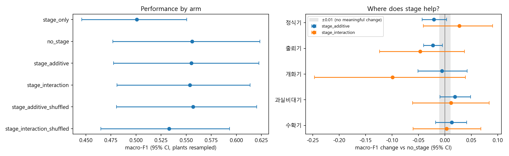
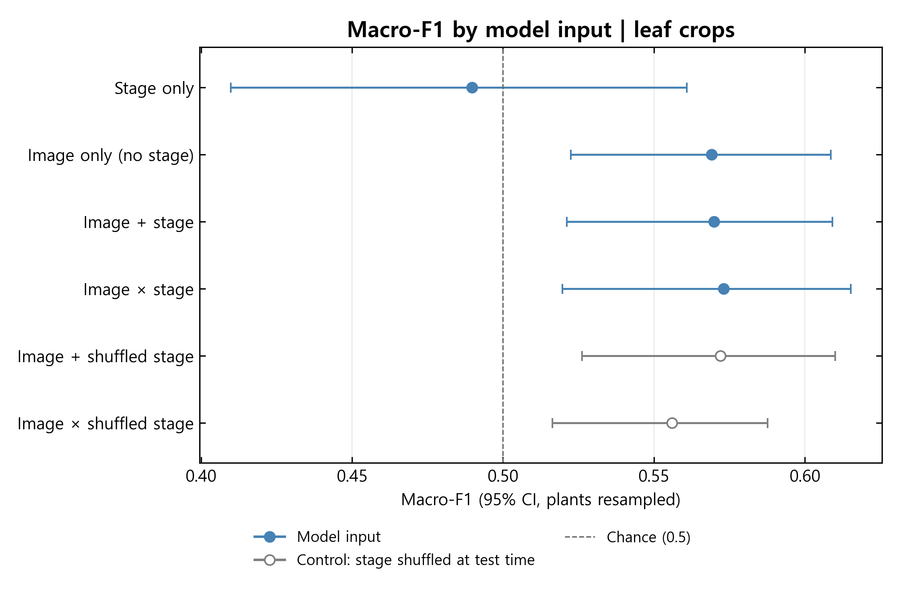
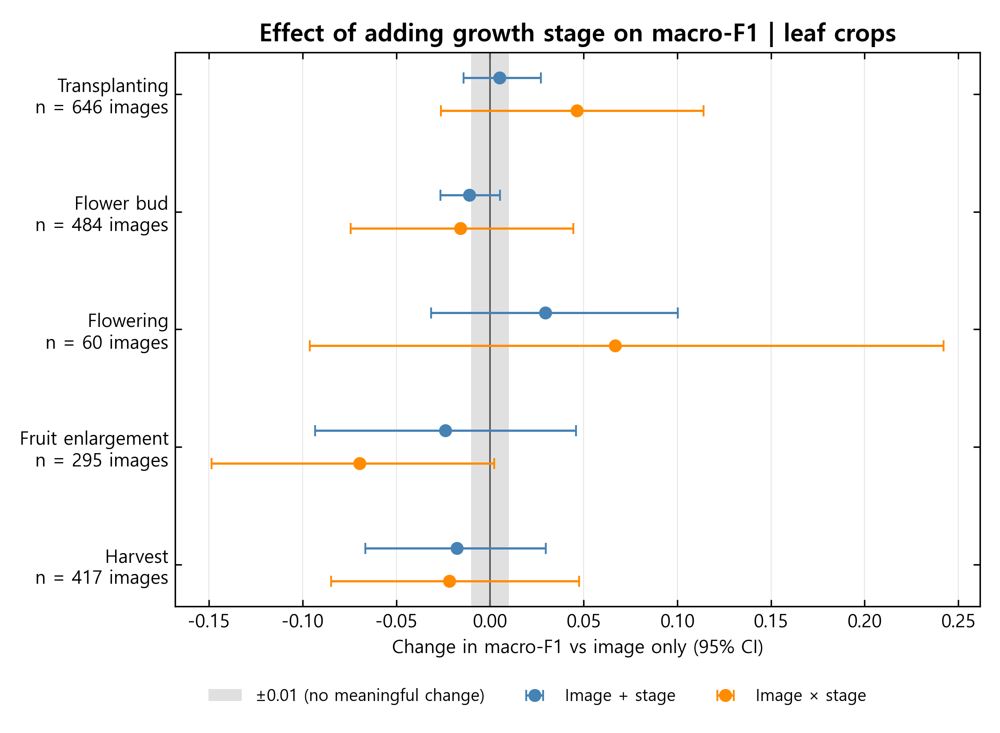
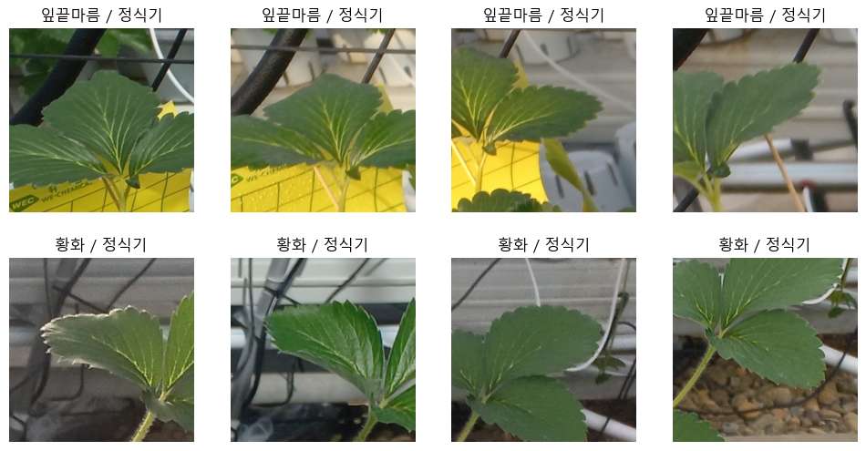

# Reported results

Source: **Growth stage for Strawberry Nutrient Deficiency**, supplied 11 November 2026; existing aggregate CSVs retain unrounded results. No model was rerun for this revision.

## Baseline decision

| Run | Images | Image-only macro-F1 | 95% CI | Interpretation |
| --- | ---: | ---: | --- | --- |
| 1 — whole images | 3,503 | 0.556 | 0.477–0.623 | Weak baseline; paired results inconclusive |
| 2 — leaf crops | 1,902 | 0.569 | 0.523–0.609 | Stage comparisons not interpreted: lower CI ≤0.60 |

The 0.01 practical margin predates run 1; the >0.60 baseline rule was introduced between runs. Both use the same 55 plants.

## Overall macro-F1

| Input | Run 1 (95% CI) | Run 2 (95% CI) |
| --- | --- | --- |
| Stage only | 0.501 (0.446–0.551) | 0.490 (0.410–0.561) |
| Image only | 0.556 (0.477–0.623) | 0.569 (0.523–0.609) |
| Image + stage | 0.555 (0.478–0.622) | 0.570 (0.521–0.609) |
| Image × stage | 0.554 (0.481–0.614) | 0.573 (0.520–0.615) |
| Image + shuffled stage | 0.557 (0.481–0.620) | 0.572 (0.526–0.610) |
| Image × shuffled stage | 0.533 (0.465–0.593) | 0.556 (0.516–0.588) |

## Paired comparisons

| Run | Comparison | Δ macro-F1 | CI | CI level | Status |
| --- | --- | ---: | --- | ---: | --- |
| 1 | Image + stage − image only | −0.001 | −0.017 to +0.016 | 97.5% | Inconclusive |
| 1 | Image × stage − image only | −0.002 | −0.048 to +0.043 | 97.5% | Inconclusive |
| 1 | Image + stage − shuffled | −0.002 | −0.019 to +0.014 | 95% | Inconclusive |
| 1 | Image × stage − shuffled | +0.021 | −0.018 to +0.057 | 95% | Inconclusive |
| 2 | Image + stage − image only | +0.001 | −0.020 to +0.022 | 97.5% | Not interpreted |
| 2 | Image × stage − image only | +0.004 | −0.035 to +0.044 | 97.5% | Not interpreted |
| 2 | Image + stage − shuffled | −0.002 | −0.021 to +0.017 | 95% | Not interpreted |
| 2 | Image × stage − shuffled | +0.017 | −0.022 to +0.057 | 95% | Not interpreted |

Run 2 numbers are provided for completeness, as in report Table 5. Small positive estimates and shuffle differences are not interpreted as evidence for stage conditioning.

[Full-precision overall results](../results/overall_comparison.csv) · [Paired comparisons](../results/paired_comparisons.csv) · [Interpretation metadata](../results/interpretation.json)

## Run 2 image-only confusion matrix

| True class | Predicted tip burn | Predicted yellowing | Recall |
| --- | ---: | ---: | ---: |
| Tip burn | 636 | 428 | 0.598 |
| Yellowing | 384 | 454 | 0.542 |

Transcribed from report Table 6, not regenerated from prediction arrays in this revision. The counts sum to 1,902 and reconstruct the stored image-only macro-F1. See [CSV](../results/leaf_crop/confusion_matrix.csv).

## Retained supplementary figures

These original figures remain unchanged. Any “Chance (0.5)” label is an illustrative reference, not a calibrated statistical null.

### Run 1: whole images

Stage-level intervals are exploratory and unadjusted.

### Run 2: model inputs — not interpreted

### Run 2: stage-specific differences — not interpreted

These appendices do not establish a beneficial or harmful stage. The failed baseline gate applies to these contrasts too. Labels list images rather than independent plants.

### Crop check

The original montage is a crop sanity check, not evidence that every crop shows its treatment-group symptom.

## Conclusion

The weak visual baseline prevents this study from answering whether growth-stage conditioning should be retained. Run 1 stage-only performance demonstrates no useful stage-only class signal at this farm. The report proposes improving label visibility and the visual baseline before repeating the stage test.
